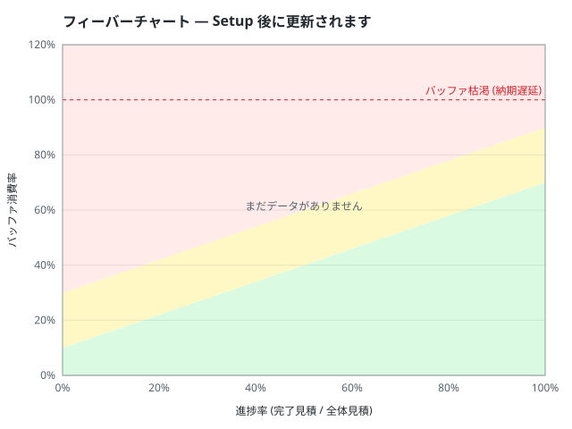

# Projects Insights Kit

**すでに Issue が入っている GitHub Project** に、次の3つを後付けするテンプレートです。
操作はすべてブラウザで完結し、手元に Python や gh CLI は要りません。既存 Issue のタイトルや本文は変更しません。

| 後付けするもの | 中身 |
|---|---|
| 三点見積 (PERT) | 楽観・最可能・悲観 (人日) を入れると **見積 (人日) = (楽観 + 4×最可能 + 悲観) / 6** を毎朝自動計算 |
| 進め方 | 工程 × 2週間スプリント / 2週間スプリント / 1週間スプリント / 工程 / なし から選択 |
| フィーバーチャート | 進捗率とバッファ消費率を毎朝計算し、Insights と SVG 図で表示 |



## セットアップ (所要 10 分)

### 1. このテンプレートからリポジトリを作る

右上の **Use this template → Create a new repository** を押し、**Owner を会社の Organization** にして作成します
(名前の例: `pm-insights`、Private で構いません)。

### 2. トークンを作って Secret に登録する

Projects は Actions 標準のトークンでは操作できないため、個人アクセストークンを1つ用意します。

**Organization の Project の場合 (fine-grained トークン)**

1. https://github.com/settings/personal-access-tokens/new を開く
2. **Resource owner** を会社の Organization にする
3. **Repository access**: Project に入っている Issue のリポジトリを選ぶ (迷ったら All repositories)
4. **Permissions**
   - Organization permissions → **Projects: Read and write**
   - Repository permissions → **Issues: Read-only**、**Pull requests: Read-only**
5. **Generate token**。Organization の設定によっては管理者の承認が必要です

**個人アカウントの Project の場合 (classic トークン)**: https://github.com/settings/tokens/new で `project` と `repo` にチェック。

作ったトークンを、手順 1 のリポジトリの **Settings → Secrets and variables → Actions → New repository secret** に
**Name: `PROJECT_TOKEN`** で登録します。

### 3. Setup を実行する

**Actions** タブ → 左の **「1. Setup (最初に1回)」** → **Run workflow** を押し、次を入力して実行します。

| 入力 | 例 | 説明 |
|---|---|---|
| Project の URL | `https://github.com/orgs/acme/projects/5` | 対象の Project |
| 計画完了日 | `2027-03-31` | **バッファを含まない**完了予定日 |
| 開始日 | `2027-01-06` | 空なら今日 |
| プロジェクトバッファ | `auto` | `auto` は三点見積から自動計算。`10` のように営業日数でも指定可 |
| 進め方 | `phase+sprint-2w` | 下の「進め方の選び方」参照 |
| 既存の見積フィールド名 | `見積日数` | 既に人日の数値フィールドがあれば名前を入れる。空なら「見積 (人日)」を新規作成 |
| 日本の祝日を除外 | ✅ | 営業日の計算から祝日を除く |

終わると、実行結果の画面 (Summary) に **このプロジェクト用の Insights 設定表** が出ます。

### 4. Project で見積を入れる

Project のテーブルに列が増えています。各 Issue に **楽観 / 最可能 / 悲観 (人日)** を入れてください。
翌朝 (すぐ反映したいときは **「2. Daily update」→ Run workflow**) に **見積 (人日)** が自動で入ります。

- 最可能だけ入れた場合は、見積 = 最可能
- 三点見積を使わず見積 (人日) を直接入れても構いません (三点が空の Issue は上書きしません)

### 5. Insights でチャートを作る

Project 右上の **Insights → New chart** で作り、**Filter** はグラフ上の入力欄、それ以外は **Configure** で設定して **Save** します。
(フィールド名を変えた場合は、Setup の Summary に出る表を使ってください。)

| チャート | Filter | Layout | X-axis | Group by | Y-axis |
|---|---|---|---|---|---|
| バーンダウン (全体) | `no:fever-metric -status:Done` | Line | Time | None | Sum of 見積 (人日) |
| バーンダウン (今のスプリント) | `no:fever-metric -status:Done sprint:@current` | Line | Time | None | Sum of 見積 (人日) |
| バーンアップ | `no:fever-metric` | Stacked area | Time | Status | Sum of 見積 (人日) |
| フィーバー (推移) | `has:fever-metric` | Line | Time | Fever Metric | Sum of Fever Value |
| フィーバー (現在のゾーン) | `has:fever-metric` | Bar | Fever Zone | None | Count of items |
| 工程別の残作業 | `no:fever-metric -status:Done` | Stacked column | Phase | Status | Sum of 見積 (人日) |

- `no:fever-metric` は、フィーバー用に自動で作るドラフト Issue 2 件を集計から外すためのものです
- Insights の推移グラフは **実際の変更時刻** で記録されるため、線は導入した日から伸びていきます (過去分は描けません)
- Time を選ぶと Group by が選べない場合は、Filter に `status:Done` を足したチャートを別に作って並べてください

以上で完了です。以後は平日 09:00 (日本時間) に自動更新されます。

## 進め方の選び方

| 選択肢 | 追加されるもの | 向いているケース |
|---|---|---|
| **`phase+sprint-2w`** (おすすめ) | Phase (要件定義〜リリース) + Sprint (2週間) | 会社の工程管理はウォーターフォールのまま、実装・テストを2週間単位で回したい |
| `sprint-2w` | Sprint (2週間) | アジャイルで進める。迷ったらこれ |
| `sprint-1w` | Sprint (1週間) | 短期・小規模、変化が激しい |
| `phase` | Phase のみ | 工程ごとの進捗だけ見たい |
| `none` | なし | 期間の区切りは使わず、全体のバーンダウンとフィーバーだけ |

スプリントは「2週間ごとに *終わらせる量* を決めて、終わったかを振り返る」ための箱です。
ウォーターフォールでも、工程 (Phase) の中をスプリントで区切ると遅れに早く気づけます。後から Setup を再実行して変更できます。

## フィーバーチャートの計算

```
進捗率        p = 完了した見積 / 全体の見積          (見積が1件も無ければ件数で計算)
バッファ消費率 b = max(0, 経過営業日 − p × 計画営業日) / バッファ営業日
ゾーン        b が 黄線 (10%→70%) 以上で 🟡、赤線 (30%→90%) 以上で 🔴   ※進捗 0%→100% で直線補間
```

**バッファの自動計算 (`auto`)**: 各 Issue の標準偏差 σ = (悲観 − 楽観) / 6 から、
`バッファ = 計画営業日 × 2 × √Σσ² / 全体見積` (約 95% の確度) を計算します。
楽観・悲観が1件も入っていない間は、計画営業日の 50% を使います。見積が入るにつれて毎朝見直されます。

「完了」は Status が `Done`、または Issue が Close されたものです。PR は集計しません。

## 設定の調整

Setup が作る `insights-kit.json` をブラウザで編集してコミットすると反映されます (Setup を再実行しても引き継がれます)。

| キー | 内容 |
|---|---|
| `done_status` | 完了とみなす Status 名 (例: `["Done", "Released"]`) |
| `schedule.extra_holidays` | 会社独自の休日 (例: `["2026-12-29", "2026-12-30"]`) |
| `fever_zones` | ゾーンの境界線 |
| `buffer_auto.k` | 自動バッファの係数 (2.0 ≒ 95%、1.0 ≒ 68%) |
| `fields` | フィールド名 (Project 側で名前を変えたらここも合わせる) |

## よくある質問

- **既存の Issue や Project が壊れませんか?** — 追加するのはフィールドとドラフト Issue 2 件だけです。書き換えるのは「見積 (人日)」(三点見積が入っている Issue のみ) と、フィーバー用のフィールドだけです。
- **Setup が `Resource not accessible` で失敗する** — トークンの Projects 権限、Resource owner、Organization の承認を確認してください。
- **Commit で失敗する** — Organization の Actions 設定でワークフローの書き込みが禁止されている可能性があります (Settings → Actions → Workflow permissions)。
- **手元で動かしたい** — `.env.example` を `.env` にコピーして `PROJECT_TOKEN` を書き、`python kit/insights_kit.py daily` を実行します (gh CLI が必要)。
