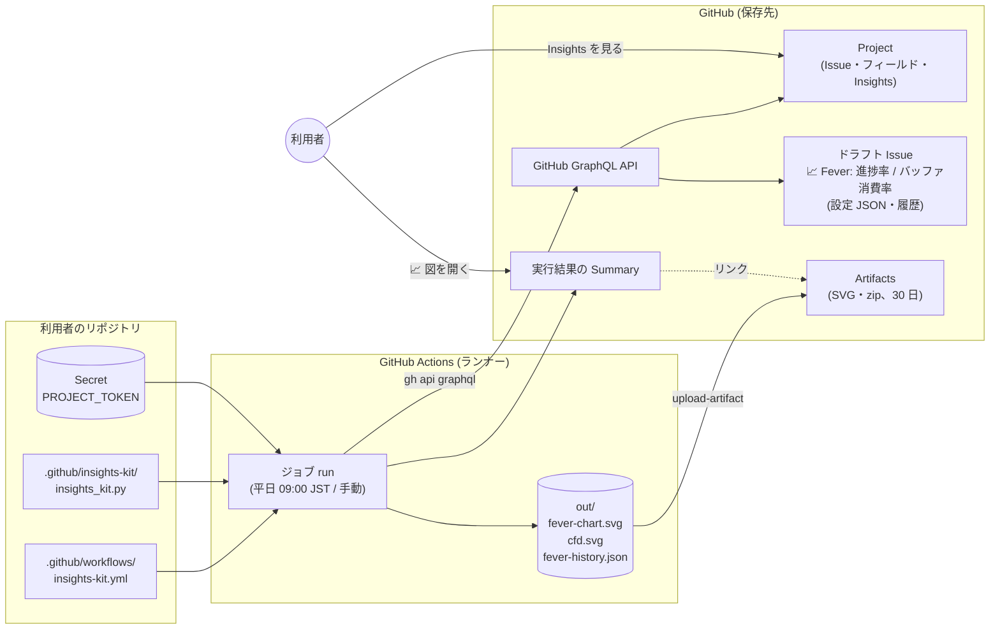
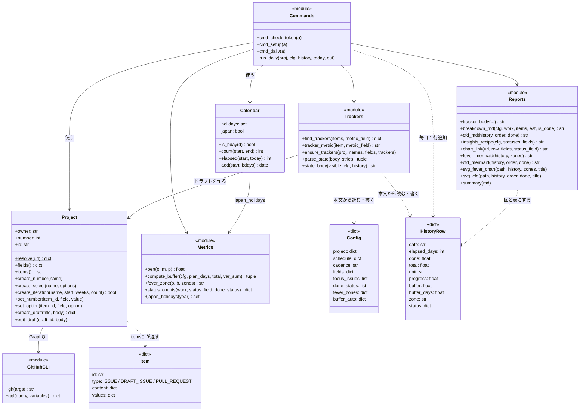
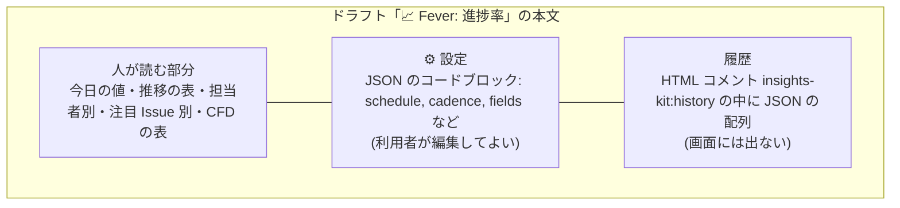
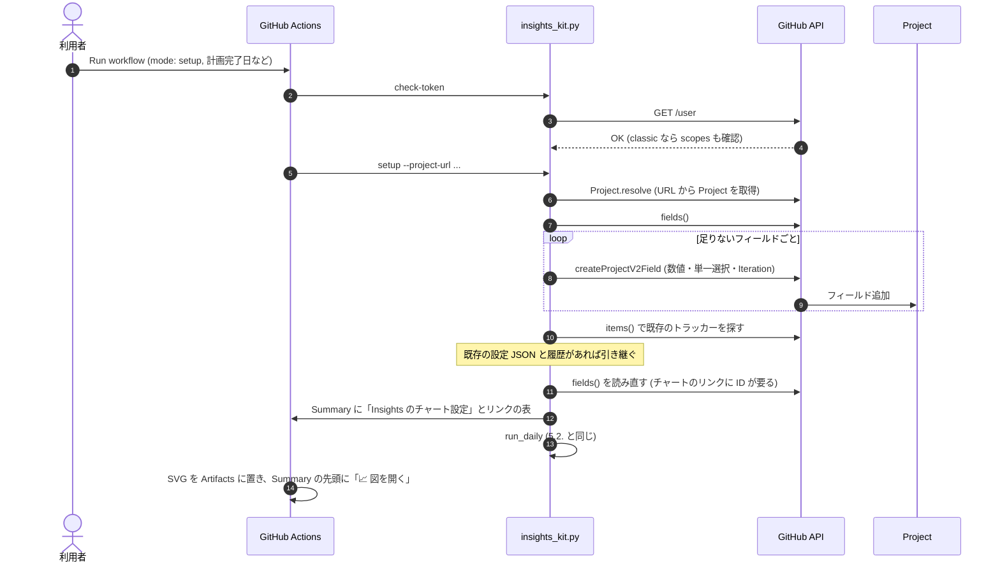
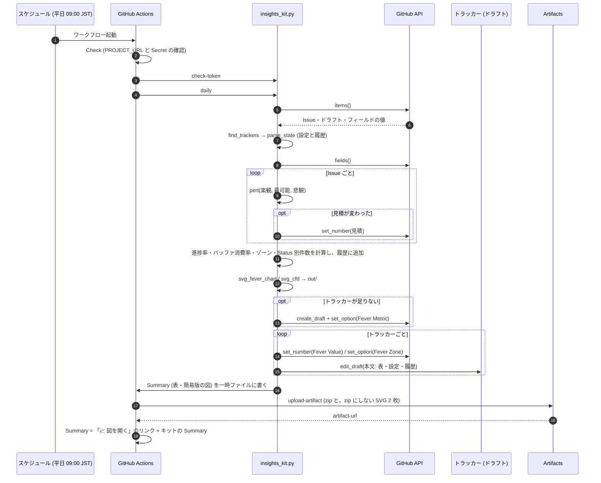
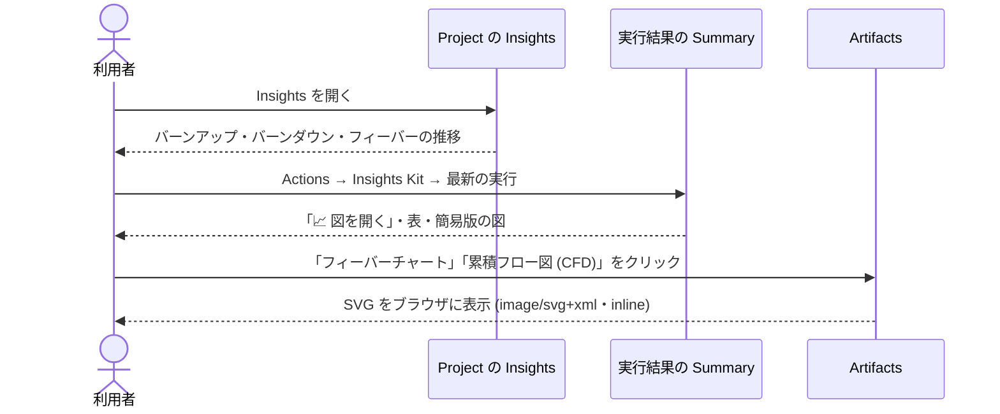
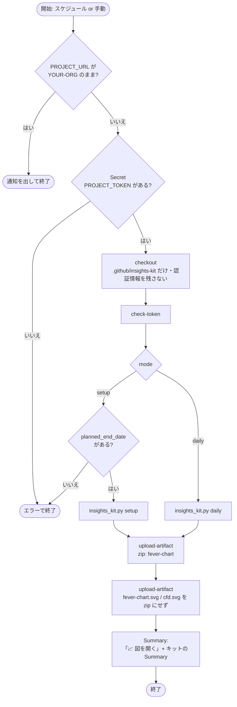
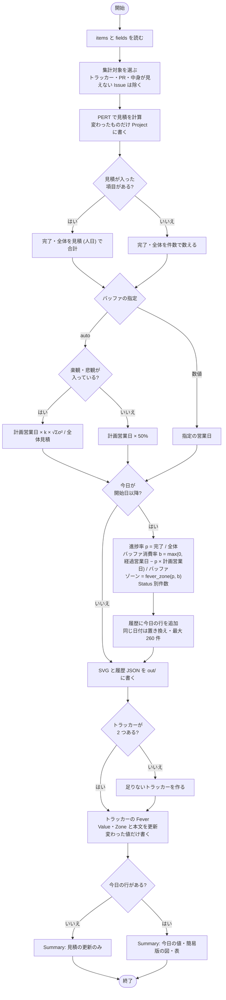
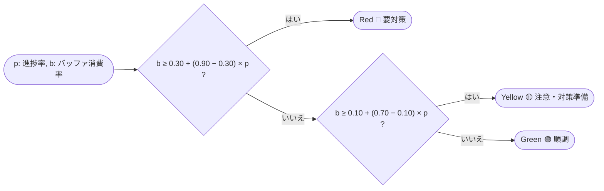
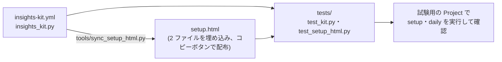

# Projects Insights Kit 設計書

このキットの構造と処理の流れをまとめます。図は Mermaid で書いているので、GitHub 上でそのまま表示されます。

- 対象: キットを保守する人、社内でレビューする人
- 対象のコード: [.github/workflows/insights-kit.yml](../.github/workflows/insights-kit.yml) と [.github/insights-kit/insights_kit.py](../.github/insights-kit/insights_kit.py)
- 使い方は [README](../README.md) を見てください

## 目次

- [1. 設計の方針](#1-設計の方針)
- [2. 全体の構成](#2-全体の構成)
  - [2.1. 何をどこで見るか](#21-何をどこで見るか)
- [3. クラス図](#3-クラス図)
  - [3.1. 主な定数](#31-主な定数)
- [4. データの保存形式](#4-データの保存形式)
- [5. シーケンス図](#5-シーケンス図)
  - [5.1. セットアップ (`mode: setup`)](#51-セットアップ-mode-setup)
  - [5.2. 毎朝の更新 (`mode: daily`)](#52-毎朝の更新-mode-daily)
  - [5.3. 図を見る](#53-図を見る)
- [6. アクティビティ図](#6-アクティビティ図)
  - [6.1. ワークフローのジョブ](#61-ワークフローのジョブ)
  - [6.2. 毎朝の計算 (`run_daily`)](#62-毎朝の計算-run_daily)
  - [6.3. ゾーンの判定 (`fever_zone`)](#63-ゾーンの判定-fever_zone)
- [7. 配布と保守](#7-配布と保守)

## 1. 設計の方針

| 方針 | 実現方法 |
|---|---|
| コピーするだけで動く | 必要なのは 2 ファイルだけ。Python 標準ライブラリと、Actions のランナーに入っている `gh` CLI だけを使う |
| 外部に情報を出さない | 通信先は GitHub API だけ。アクションは GitHub 公式の `actions/checkout` と `actions/upload-artifact` だけ。日本の祝日もコード内で計算する。テスト (`tests/test_setup_html.py`) で確認している |
| リポジトリに書き込まない | ワークフローの権限は `contents: read`。設定と履歴は Project 内のドラフト Issue の本文に保存する |
| 既存の Issue を変えない | 書き込むのは Project のフィールドの値 (見積など) と、キットが作るドラフト Issue だけ |
| 入力を安全に扱う | ワークフローの入力値は環境変数で渡す (スクリプトインジェクション対策) |

## 2. 全体の構成

### 2.1. 何をどこで見るか

| 図・情報 | 作る場所 | 見る場所 |
|---|---|---|
| バーンアップ・バーンダウン | Project の Insights (利用者がチャートを保存) | Project の Insights |
| フィーバーの推移 (日付が横軸) | トラッカーのドラフトに書いた `Fever Value` / `Fever Zone` を Insights で集計 | Project の Insights |
| フィーバーチャート (進捗率が横軸) | `svg_fever_chart` → Artifacts | Summary の「📈 図を開く」 |
| 累積フロー図 (CFD) | `svg_cfd` → Artifacts | Summary の「📈 図を開く」 |
| 簡易版の折れ線 | `fever_mermaid` / `cfd_mermaid` (Mermaid) | Summary の下の方 |
| 数字の表 | `tracker_body` / `breakdown_md` / `cfd_md` | ドラフト「📈 Fever: 進捗率」の本文と Summary |

## 3. クラス図

`insights_kit.py` のクラスは `Project` と `Calendar` の 2 つだけです。そのほかの処理は関数で、データは辞書 (dict) で受け渡します。
下の図では、関数をまとめて «module» として、主な辞書の形を «dict» として示します。

### 3.1. 主な定数

| 定数 | 意味 |
|---|---|
| `DEFAULT_FIELDS` | キットが使う Project のフィールド名 (Status、楽観・最可能・悲観、見積、Fever Value / Metric / Zone、Phase、Sprint) |
| `METRICS` | トラッカーの指標。`Progress %` (進捗率) と `Buffer %` (バッファ消費率) |
| `ZONES` | フィーバーのゾーン。Green / Yellow / Red |
| `STATE_METRIC` | 設定と履歴を保存するトラッカー (`Progress %`) |
| `MAX_HISTORY` / `BODY_LIMIT` | 履歴の保存件数 (260 営業日) と、ドラフト本文の文字数の上限 (60,000) |

## 4. データの保存形式

設定と履歴は、ドラフト「📈 Fever: 進捗率 (Progress %)」の本文に、人が読む部分と一緒に保存します。

- 読み込み: `parse_state` が正規表現 `CONFIG_RE` / `HISTORY_RE` で取り出す
- 書き込み: `state_body` が組み立てる。本文が `BODY_LIMIT` を超える場合は、履歴を古い方から削る
- もう 1 つのトラッカー「📈 Fever: バッファ消費率 (Buffer %)」の本文は、人が読む部分だけ

各トラッカーには、Project のフィールドにも値を書きます。Insights はこの値を集計します。

| フィールド | 進捗率のトラッカー | バッファ消費率のトラッカー |
|---|---|---|
| `Fever Metric` | `Progress %` | `Buffer %` |
| `Fever Value` | 進捗率 (%) | バッファ消費率 (%) |
| `Fever Zone` | 今日のゾーン | 今日のゾーン |

## 5. シーケンス図

### 5.1. セットアップ (`mode: setup`)

### 5.2. 毎朝の更新 (`mode: daily`)

### 5.3. 図を見る

## 6. アクティビティ図

### 6.1. ワークフローのジョブ

### 6.2. 毎朝の計算 (`run_daily`)

### 6.3. ゾーンの判定 (`fever_zone`)

ゾーンの境界線は、進捗率 p に応じて直線で動きます (既定: 黄 10%→70%、赤 30%→90%)。

## 7. 配布と保守

| テスト | 確認すること |
|---|---|
| `test_setup_html.py` | setup.html の埋め込みが元のファイルと一致する。GitHub 公式以外のアクションや別リポジトリを使っていない。通信のライブラリを使わず、URL が GitHub だけ。日本の祝日の計算 |
| `test_kit.py` | CFD の集計と帯の順番、SVG が壊れていない、本文の文字数の上限、Insights のチャート設定表とリンク、Mermaid の図の値 |
